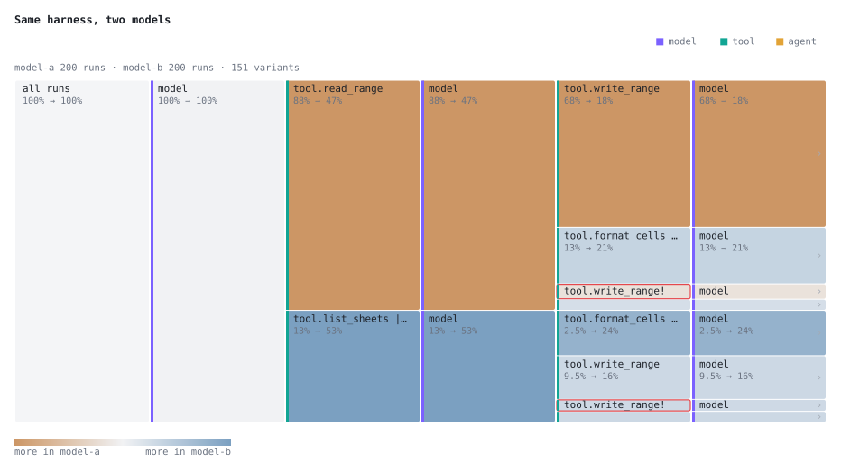

<p align="center"></p>

<h1 align="center">vega-agent</h1>

<p align="center">A visualization grammar for agent traces.<br>
<a href="https://sjoerdvink99.github.io/vega-agent/">Documentation</a> · <a href="https://sjoerdvink99.github.io/vega-agent/quickstart/">Quickstart</a> · <a href="examples">Examples</a></p>

You give it two things: your records, as your agent logs them, and a JSON view spec, as in Vega-Lite. The spec's `trace` mapping says which field is the run, the actor, the name and the time. vega-agent maps every run to a trace in a grammar of agent processes, and compiles the view to a [Vega](https://vega.github.io/vega/) spec, so it renders the same in a browser, in Node, in a notebook or in a paper.

```
records + view spec  →  traces in the grammar  →  Vega spec  →  figure
```

```jsonl
{"session":"s09","version":"after","type":"llm","start":0.0,"end":1.0}
{"session":"s09","type":"tool","tool":"read","start":1.1,"end":1.5}
{"session":"s09","type":"tool","tool":"write","start":2.5,"end":2.8,"error":"patch did not apply"}
```

```json
{
  "mark": "variants",
  "level": "names",
  "data": { "url": "events.jsonl" },
  "trace": { "run": "session", "actor": "type", "name": "tool", "start": "start", "end": "end", "failed": "error", "group": "version" }
}
```

Each session becomes a trace such as `model -> tool.read -> model -> tool.write! -> model`; Vega counts the distinct runs, compares the two versions and draws them.



## Install

```bash
pip install vega-agent    # Python: import vega_agent as va
npm install vega-agent    # TypeScript and the browser
```

## Use

```ts
import { compile, embed, render } from "vega-agent";

const trace = { run: "session", actor: "type", name: "tool", start: "start", end: "end", failed: "error" };

const svg = await render({ mark: "transitions", data: { url: "events.jsonl" }, trace });

const view = await embed(element, {
  data: { url: "events.jsonl" },
  trace,
  vconcat: [
    { mark: "variants", level: "names", params: [{ name: "picked", select: "click" }], highlight: { param: "picked" } },
    { mark: "sequences", filter: { param: "picked" } },
  ],
});
view.on("select", ({ picked }) => showRuns(picked));

const vega = compile({ mark: "activities", data: { values: events }, trace });
```

Telemetry in a [standard](https://sjoerdvink99.github.io/vega-agent/standards/), such as OpenTelemetry spans, needs no mapping: `{ "mark": "variants", "data": { "url": "spans.jsonl" } }`.

```python
import vega_agent as va

va.Chart({"mark": "variants", "level": "names", "data": {"values": events}, "trace": {"run": "session", "actor": "type", "name": "tool"}})

runs = va.Corpus(va.read(events, {"run": "session", "actor": "type", "name": "tool", "failed": "error"}))
runs.chart(mark="transitions")
runs.conformance("(model -> tool[])* -> model")
runs.find("(model -> tool!){3,}")
```

## The grammar

Runs map to expressions of a grammar of agent processes. You never write a run by hand; the grammar is what views abstract, compare and query, and how you write a design or a query:

```
agent loop     (model -> tool[])* -> model
routing        model.route -> (agent.billing | agent.tech | model.answer)
orchestrator   model.plan(=> task:text[]) -> agent.worker{ (model -> tool[])* -> model }[] -> model.synthesize
```

Five actors (`model`, `tool`, `agent`, `human`, `code`), sequence `->` and parallel `||`, each repeated `{m,n}` and `[m,n]`, choice `|`, nested contexts `{…}` and failure `!`; `* + ?` and `[]` are shorthands. A trace is an expression without choice or open repetition; a design accepts traces, and a `diagram` draws it; a query finds sub-processes and `highlight`s them in a view. See [Grammar](https://sjoerdvink99.github.io/vega-agent/grammar/).

A corpus of traces has one relational form, five [tables](https://sjoerdvink99.github.io/vega-agent/tables/): `runs`, with each run's variant at every level; `variants`; their `tokens`; the `steps` of each distinct trace; and the runs' `times`. Views, analyses and exports all read them: `tables(runs)` in TypeScript, `va.tables(runs)` in Python.

## Data

| Stage | Property | |
|---|---|---|
| Read | `data` | records inline (`values`) or from a file (`url`), in any [standard](https://sjoerdvink99.github.io/vega-agent/standards/) or your own shape |
| Filter | `transform` | the records to keep: `equal`, `oneOf`, `range`, `valid`, `and`, `or`, `not` |
| Map | `trace` | fields to the grammar: `run`, `actor`, `name`, `step`, `parent`, `start`, `end`, `failed`, `group` |
| Split | `facet` | one panel per value of a field, for any number of models, versions or outcomes |
| Abstract | `level` | every run as a sequence at `full`, `names`, `actors` or `loops` detail |
| Aggregate | `mark`, `limit` | variants, prefixes, pairs, bins, ranked and folded in the Vega dataflow |

Ten thousand runs compile and render in about a second, and no run is dropped from a count. See [Data](https://sjoerdvink99.github.io/vega-agent/data/).

## Views

| Mark | Shows |
|---|---|
| `diagram` | a design, written as an expression, as a railroad diagram |
| `timeline` | when each step of a trace ran, per step or per agent |
| `handoffs` | how control passes between agents and people |
| `icicle` | runs merged by shared prefix |
| `variants` | each distinct run, ranked by frequency |
| `transitions`, `graph` | how often each step follows another, as a matrix or a process graph |
| `sankey` | how runs flow through their first steps |
| `activities` | how often each step occurs and fails |
| `sequences` | every run as a row of steps |
| `distribution` | how runs spread over their length, failures or duration |
| `durations` | how long each step takes |
| `projection` | variants placed so that similar runs lie close |
| `vconcat`, `hconcat` | views stacked or side by side, with one legend |
| `facet` | one panel per value of a field |

With two groups of runs, the corpus marks show the difference; with more, a `facet` draws one panel per group. Tooltips, selections, linking and filtering are declared in the spec, and every interactive state is a spec. See [Views](https://sjoerdvink99.github.io/vega-agent/views/) and [Interaction](https://sjoerdvink99.github.io/vega-agent/interaction/).

## How it works

`compile(spec)` returns a self-contained Vega spec. vega-agent does what only the grammar can: it maps records to traces, writes them as tables, and lays out what must stay put, such as railroad diagrams and the icicle's prefix tree. The spec ships the tables, with each distinct trace once and a short row per run. Everything after that is Vega: each run joins its variant, and counting, ranking and folding are dataflow transforms; the icicle is a `partition`, and positions, axes, legends and tooltips are Vega scales and guides. Selections are Vega data stores of run ids, so linked views recount as you click, and the compiled spec runs unchanged in the [Vega Editor](https://vega.github.io/editor/). See [Compiling to Vega](https://sjoerdvink99.github.io/vega-agent/vega/).

## Standards

Reads OpenTelemetry GenAI and MCP, OpenInference, OpenLLMetry, Langfuse, the Vercel AI SDK, OpenAI, Anthropic and Gemini transcripts, the OpenAI Agents SDK, LangSmith and ATIF. Writes OTLP/JSON, XES, OCEL 2.0, BPMN 2.0 and pm4py process trees. The mapping is one data file, [`grammar/conventions.json`](grammar/conventions.json). See [Standards](https://sjoerdvink99.github.io/vega-agent/standards/).

## Layout

```
grammar/    the contract both languages pass: fixtures, standards, mappings, specs, conventions, view.schema.json
js/         vega-agent, the TypeScript library: the view compiler to Vega
python/     vega-agent, the Python package: grammar, corpus analysis, readers, exports, notebook charts
examples/   a TypeScript explorer, a CI report, a plain web page, notebooks
docs/       the documentation site
```

## Contribute

```bash
make install    # Node 22+, Python 3.10+
make check      # lint, both test suites, generated files, examples
```

See [CONTRIBUTING.md](CONTRIBUTING.md). Released under the [MIT License](LICENSE). Cite with [CITATION.cff](CITATION.cff).
